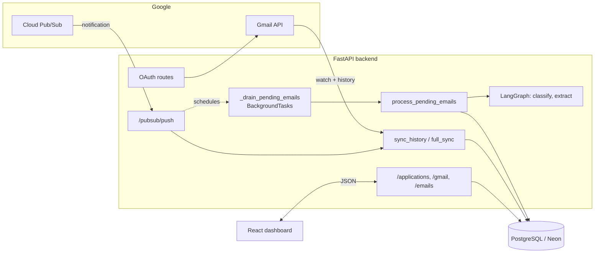
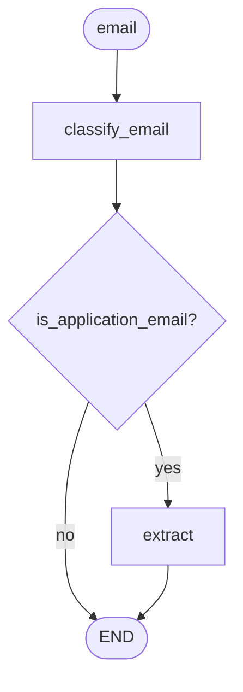

# mail.trace

An AI agent that reads your Gmail inbox and automatically tracks job applications.

Instead of maintaining a spreadsheet, `mail.trace` watches your inbox, classifies job‑related
email, extracts the company / role / stage / links / deadlines with an LLM, and keeps a
deduplicated application list with a per‑application timeline.

---

## Table of contents

- [What it does](#what-it-does)
- [System design](#system-design)
- [Data model](#data-model)
- [Reliability & correctness](#reliability--correctness)
- [Tech stack](#tech-stack)
- [API reference](#api-reference)
- [Repository layout](#repository-layout)
- [Running locally](#running-locally)
- [Configuration](#configuration)
- [Design decisions & trade-offs](#design-decisions--trade-offs)
- [Known limitations & future work](#known-limitations--future-work)

---

## What it does

1. **Connects to Gmail** with read‑only OAuth 2.0 (offline access, PKCE).
2. **Subscribes to push notifications** via the Gmail `watch` API + Google Cloud Pub/Sub.
3. **Syncs incrementally** using the Gmail History API (and falls back to a full resync when
   a history cursor expires).
4. **Stores raw email** as `PENDING` rows, deduplicated by Gmail message id.
5. **Classifies + extracts** each email with a LangGraph workflow (job‑related? company, role,
   status, action link, event date).
6. **Persists structured results** as `Application` (one per opportunity), `ApplicationEvent`
   (timeline), and `ProcessedEmail` (audit/dedup ledger).
7. **Serves a dashboard** (React) with an application list, per‑status counts, a detail
   timeline, and manual status/close controls.

---

## System design

### High-level components



### Request path vs. background path (sequence)

```mermaid
sequenceDiagram
    autonumber
    participant G as Google (Gmail / Pub/Sub)
    participant API as FastAPI /pubsub/push
    participant SYNC as sync_history / full_sync
    participant DB as Postgres
    participant BG as _drain_pending_emails
    participant PROC as process_pending_emails
    participant LLM as LangGraph

    rect rgb(235,245,255)
    Note over G,DB: SYNCHRONOUS REQUEST (fast)
    G->>API: POST /pubsub/push {message.data}
    API->>API: base64-decode -> email_address, historyId
    API->>SYNC: sync_history(..., fallback_history_id)
    SYNC->>DB: _lock_cursor() SELECT ... FOR UPDATE
    SYNC->>G: history.list(startHistoryId, pageToken)
    loop each message_id
        SYNC->>DB: _email_exists? ; session.add(Email(status=PENDING))
    end
    SYNC->>DB: set_cursor(historyId); commit
    alt Gmail 404 (cursor expired)
        API->>SYNC: full_sync(...)
        SYNC->>DB: re-list all, re-persist, re-anchor cursor; commit
    end
    API->>BG: background_tasks.add_task(_drain_pending_emails)
    API-->>G: 200 {"status":"ok"}   %% sent BEFORE processing starts
    end

    rect rgb(245,240,255)
    Note over BG,LLM: BACKGROUND (slow, non-blocking)
    BG->>DB: with Session(engine) as session
    BG->>PROC: process_pending_emails(session, limit=25)
    PROC->>DB: claim_pending_emails(): PENDING -> PROCESSING; commit
    loop each claimed email
        PROC->>LLM: graph.invoke(email_to_state(email))
        LLM-->>PROC: is_application_email, company, role, status, ...
        alt relevant
            PROC->>DB: upsert Application + ApplicationEvent + ProcessedEmail("processed")
        else irrelevant
            PROC->>DB: ProcessedEmail("skipped")
        end
        PROC->>DB: Email.status = COMPLETED; commit
    end
    Note over PROC: on error -> Email.status = FAILED (via _record_processing_failure)
    end
```

Key idea: **the Pub/Sub HTTP response never waits on the LLM.** Sync is synchronous and fast;
classification runs in a FastAPI `BackgroundTask` on a fresh DB session.

### The LangGraph workflow

Defined in `backend/app/graph/graph.py`. It is a two‑node graph (persistence is **outside**
the graph, in the service layer):



- `classify_email` — asks the model whether the email is job‑related.
- `extract` — structured output: `company`, `role`, `status`, `summary`, `action_url`, `event_date`.
- The LLM is `mimo-v2.5` via the OpenCode endpoint (`ChatOpenAI`, structured output).

Persistence and deduplication live in `backend/app/services/email_processor.py`, not in the graph.

---

## Data model

Defined with SQLModel in `backend/app/db/models.py`. Five tables:

| Table | Purpose | Notable columns |
|---|---|---|
| `applications` | One row per job opportunity (denormalized latest snapshot) | `company`, `role`, `match_key`, `status`, `is_closed`, `previous_status`, `latest_note`, `latest_action_url`, `latest_event_date`, `source_email_id` |
| `application_events` | Timeline entry per follow‑up email | `application_id` (FK), `status`, `note`, `action_url`, `event_date`, `source_email_id` (**unique**) |
| `processed_emails` | Ingestion dedup + audit ledger | `message_id` (**unique**), `thread_id`, `is_application_email`, `verdict` (`processed`/`skipped`/`error`), `application_id`, `event_id` |
| `sync_state` | Per‑mailbox Gmail history cursor | `email_address` (**unique**), `history_id` |
| `emails` | Raw synced email, deduped by message id | `message_id` (**unique**), `thread_id`, `subject`, `body`, `status`, `error`, `updated_at` |

Enums:

- `ApplicationStatus`: `RECOMMENDED, APPLIED, UNDER_REVIEW, OA, INTERVIEW, INTERVIEW_PASSED, INTERVIEW_REJECTED, OFFER, REJECTED, WITHDRAWN, CLOSED`
- `EmailStatus`: `PENDING, PROCESSING, COMPLETED, FAILED`

**Matching / dedup keys**

- Raw email dedup: unique `emails.message_id`.
- Application grouping: `match_key = normalize(company) + "|" + normalize(role)`, with a
  thread‑id match and a generic‑role fallback (`app/services/email_processor.py::find_matching_application`).
- Per‑email idempotency: unique `application_events.source_email_id` and unique
  `processed_emails.message_id`.

---

## Reliability & correctness

- **Atomic cursor advance** — `sync_history` persists all messages and only then updates the
  history cursor and commits. A mid‑sync failure leaves the cursor untouched, so the next
  notification re‑reads the same window (no loss, at worst re‑fetch).
- **Expired‑cursor recovery** — a Gmail `404` raises `HistoryExpiredError`, which the handler
  recovers from with `full_sync` (a deduped full mailbox re‑read that re‑anchors the cursor).
- **Concurrency** — `claim_pending_emails` uses `SELECT … FOR UPDATE SKIP LOCKED` so concurrent
  workers claim disjoint batches (Postgres; a no‑op on SQLite).
- **Idempotent processing** — reprocessing an email is a no‑op: a `ProcessedEmail` with verdict
  `processed`/`skipped` short‑circuits, and an existing `ApplicationEvent` is reused.
- **Failure recording** — a failed classification/extraction rolls back and records
  `EmailStatus.FAILED` + an error `ProcessedEmail`; failed emails can be retried
  (`retry_failed`).
- **Additive migrations** — `apply_migrations` reconciles pre‑existing tables on startup
  (`ALTER TABLE ADD COLUMN`, index creation), idempotent and safe to re‑run.

---

## Tech stack

- **Backend**: Python 3.11+, FastAPI, Uvicorn, SQLModel / SQLAlchemy 2.0
- **Database**: PostgreSQL (Neon)
- **AI workflow**: LangGraph + LangChain (`ChatOpenAI`, structured output)
- **Email**: Gmail REST API, Google Cloud Pub/Sub, OAuth 2.0 (read‑only, PKCE)
- **Frontend**: React 18, TypeScript, Vite, React Router, axios

---

## API reference

| Method | Path | Description |
|---|---|---|
| `GET` | `/auth/google` | Start OAuth (redirects to Google consent). |
| `GET` | `/auth/google/callback` | Validate state, exchange code, store token. |
| `POST` | `/gmail/watch` | Register/renew the Gmail push watch; seeds the cursor. |
| `POST` | `/gmail/sync` | Full mailbox resync; returns `{fetched, processed}`, schedules background processing. |
| `POST` | `/pubsub/push` | Pub/Sub delivery endpoint; syncs then schedules background processing. |
| `POST` | `/emails/process` | Manually drain pending emails (`limit`, `retry_failed`, `message_id`). |
| `GET` | `/applications` | List applications (`status`, `company`, `search`, `limit`, `offset`, `include_closed`). |
| `GET` | `/applications/stats` | Counts: `{total, closed, by_status}`. |
| `GET` | `/applications/{id}` | Single application. |
| `GET` | `/applications/{id}/events` | Timeline events for an application. |
| `PATCH` | `/applications/{id}` | Update `status`, `is_closed`, or `notes`. |

Interactive docs are available at `/docs` when the backend is running.

---

## Repository layout

```
backend/
  app/
    main.py                     # FastAPI app, OAuth/watch/pubsub/sync routes, background drain
    api/applications.py         # /applications read/write router
    db/
      database.py               # engine, session dependency, create_db_and_tables
      models.py                 # SQLModel tables + enums
      migrations.py             # idempotent additive migrations
      email_processing.py       # claim / status-transition helpers
    gmail/
      oauth.py                  # OAuth 2.0 flow + token storage
      service.py                # authenticated Gmail client + watch registration
      sync.py                   # history sync, full sync, MIME parsing
    graph/graph.py              # LangGraph classify -> extract workflow
    services/email_processor.py # drain -> LangGraph -> persist Application/Event/ProcessedEmail
frontend/
  src/pages/                    # ApplicationsPage, ApplicationDetailPage, SettingsPage
  src/services/api.ts           # typed API client
```

---

## Running locally

### 1. Backend

```bash
cd backend
python3 -m venv .venv
.venv/bin/pip install -r requirements.txt
# create backend/.env (see Configuration below)
.venv/bin/uvicorn app.main:app --reload --port 8000
```

On startup the app creates/migrates tables (`create_db_and_tables`) and is then available at
http://localhost:8000 (docs at `/docs`).

> The app imports LangGraph at startup, which builds the LLM client from `OPENCODE_API_KEY`.
> The backend will not start without it.

### 2. Frontend

```bash
cd frontend
npm install
npm run dev
```

Open http://localhost:5173. Vite proxies `/api` (stripping the prefix) and `/auth` to
`http://localhost:8000`, so no CORS/proxy config is needed in dev.

### 3. Use it

1. **Settings → Connect Gmail** and complete the Google consent flow (writes `backend/token.json`).
2. **Register watch** to subscribe to push notifications (needs `GMAIL_PUBSUB_TOPIC`).
3. **Run full sync** to backfill recent mail, or wait for Pub/Sub pushes.

> Pub/Sub cannot reach `localhost`. For real‑time push, expose the backend (e.g. `ngrok http 8000`)
> and set that URL as the push subscription endpoint in Google Cloud. For a local demo, use
> **Run full sync** — it performs the same ingestion and background processing without Pub/Sub.

---

## Configuration

`backend/.env`:

```
OPENCODE_API_KEY=            # LLM access (required)
DATABASE_URL=                # PostgreSQL connection string (required)
GOOGLE_CLIENT_ID=            # OAuth client (required)
GOOGLE_CLIENT_SECRET=        # OAuth client secret (required)
GOOGLE_REDIRECT_URI=http://localhost:8000/auth/google/callback
GMAIL_PUBSUB_TOPIC=projects/<project>/topics/<topic>   # required for /gmail/watch
GMAIL_TOKEN_PATH=token.json  # optional; defaults to backend/token.json
```

The Google Cloud OAuth client must whitelist `GOOGLE_REDIRECT_URI` as an authorized redirect URI.

---

## Design decisions & trade-offs

- **Pub/Sub push + History API, not polling** — near‑real‑time ingestion with minimal API quota,
  at the cost of a public webhook and a weekly‑expiring watch.
- **`BackgroundTasks`, not Celery** — zero extra infrastructure and the HTTP response is never
  blocked by LLM latency. The trade‑off is durability (see limitations).
- **Separate raw email (`emails`) and structured (`applications`) tables** — ingestion can never
  be blocked by (or coupled to) the LLM, and raw email is replayable.
- **Idempotency via `ProcessedEmail` + unique `ApplicationEvent.source_email_id`** — re‑delivery
  and re‑sync cannot create duplicate applications or timeline entries.
- **Additive hand‑written migrations, not Alembic** — enough for a small, evolving schema and
  safe to run on every startup (idempotent).
- **Read‑only Gmail scope** — the app can never modify your mailbox.

---

## Known limitations & future work

- **Non‑durable background processing.** Work runs in‑process; if the process dies after an email
  is marked `PROCESSING`, it is not automatically retried. A durable queue (Celery/RQ) or a
  Postgres lease/heartbeat column would fix this.
- **No stale‑`PROCESSING` reclaim.** Recovery would need a lease/owner field so a live worker's
  email is never reset; not implemented.
- **Classifier swallows LLM errors.** `classify_email` catches exceptions and treats the email as
  non‑job‑related, so a transient LLM failure is recorded as `skipped` rather than `FAILED`.
- **No watch auto‑renewal.** The Gmail watch must be re‑registered roughly weekly.
- **Batch cap.** Each background drain processes at most 25 emails; larger bursts drain on the
  next trigger.
- **Single‑user.** OAuth token is stored on disk and API routes are unauthenticated — fine for a
  personal tool, not for multi‑tenant use.
