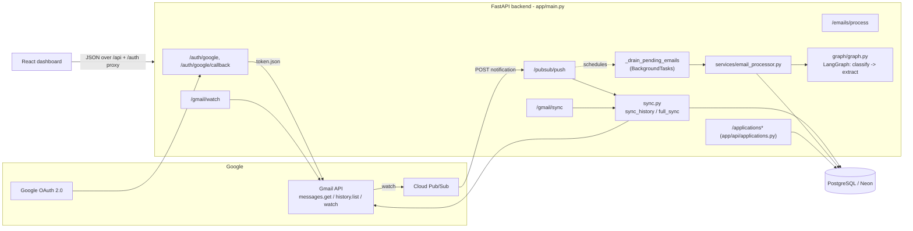
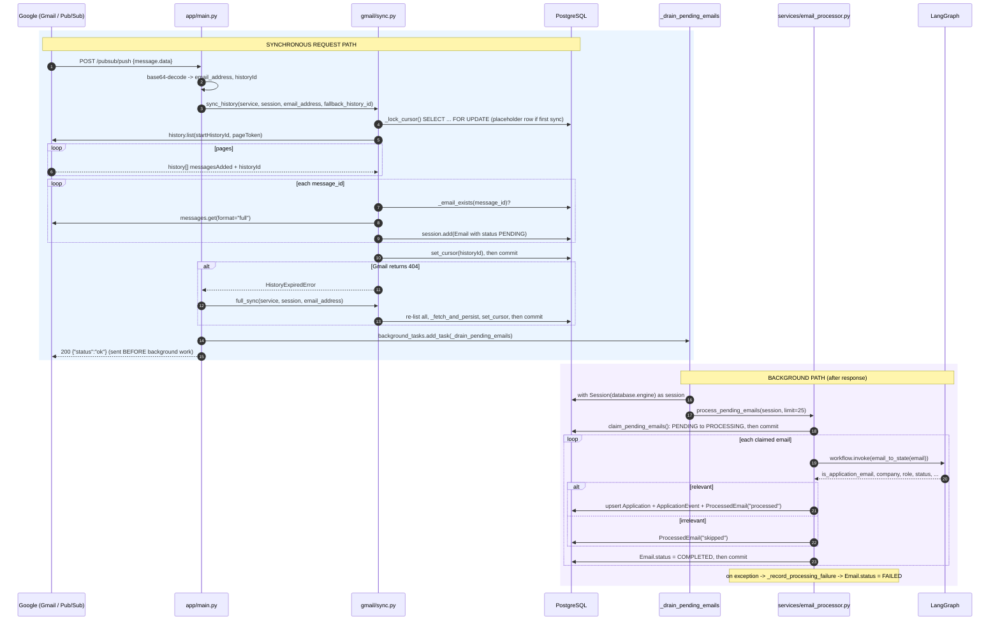
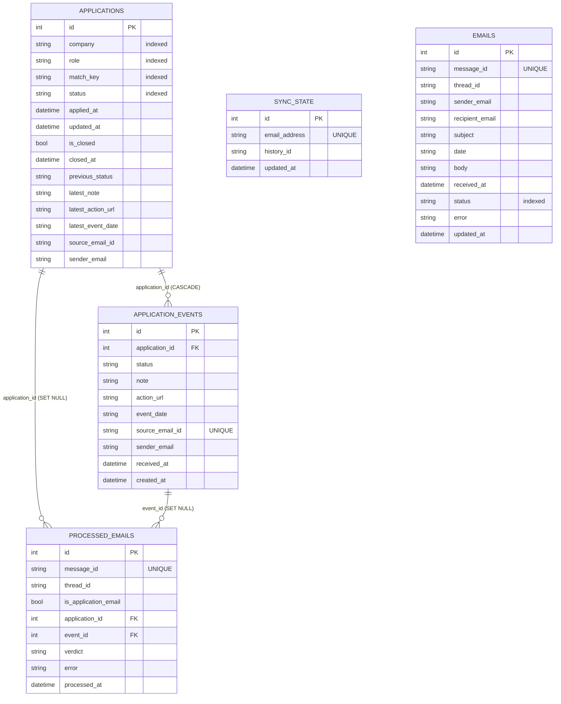
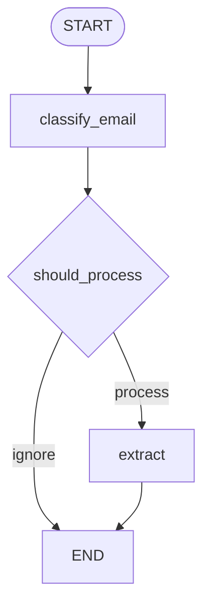

# MailTrace — Project Guide & Backend Interview Preparation

> **Source of truth:** the code in this repository. Every function, file, and schema detail below
> was verified by inspecting the code. Anything not verifiable in the code is explicitly marked
> **unverified** or **future work**.
>
> **State of the repo at time of writing:** branch `master` @ `774b5b2`. The automated test suite
> was intentionally **removed** in commit `c42445b` (`chore: remove test suite`); there is currently
> no `backend/tests/` directory. This guide therefore describes tests as *historical* and never
> claims a test passes.

---

## Table of contents

1. [Project overview](#1-project-overview)
2. [System architecture](#2-system-architecture)
3. [End-to-end data flow](#3-end-to-end-data-flow)
4. [Codebase walkthrough](#4-codebase-walkthrough)
5. [Database design](#5-database-design)
6. [API reference](#6-api-reference)
7. [Gmail integration](#7-gmail-integration)
8. [LangGraph and email processing](#8-langgraph-and-email-processing)
9. [Background processing and reliability](#9-background-processing-and-reliability)
10. [Testing guide](#10-testing-guide)
11. [Design decisions and trade-offs](#11-design-decisions-and-trade-offs)
12. [Known limitations and future improvements](#12-known-limitations-and-future-improvements)
13. [Interview preparation](#13-interview-preparation)
14. [Revision cheat sheet](#14-revision-cheat-sheet)

---

## 1. Project overview

**Problem.** Job seekers get dozens of application-related emails (confirmations, assessments,
interviews, offers, rejections) across many senders. Tracking them manually in a spreadsheet is
tedious and error-prone.

**What MailTrace does.** It connects to a Gmail mailbox (read-only), watches for new mail via
Google Pub/Sub, incrementally syncs messages with the Gmail History API, stores raw email, and uses
a LangGraph + LLM pipeline to classify each email and extract structured job-application data. It
maintains one `Application` row per opportunity with a per-application timeline of
`ApplicationEvent` rows, and serves a React dashboard.

### Features actually implemented (verified)

| Feature | Where |
|---|---|
| Gmail OAuth 2.0 (read-only, offline, PKCE), token on disk, auto-refresh | `app/gmail/oauth.py`, routes in `app/main.py` |
| Gmail `watch` registration → Pub/Sub topic; per-mailbox cursor seed | `app/gmail/service.py::register_watch` |
| Pub/Sub push webhook (base64 decode, malformed-payload handling) | `app/main.py::pubsub_push` |
| Incremental sync via History API + pagination + cursor persistence | `app/gmail/sync.py::sync_history` |
| Full-mailbox resync recovery on expired history cursor | `app/gmail/sync.py::full_sync` |
| Raw email persisted as `PENDING`, deduped by message id | `app/gmail/sync.py::_fetch_and_persist` |
| Idempotent additive migrations on startup | `app/db/migrations.py::apply_migrations` |
| Claim pending emails with row locking | `app/db/email_processing.py::claim_pending_emails` |
| LangGraph classify → extract | `app/graph/graph.py` |
| Application matching, persistence, timeline, audit ledger | `app/services/email_processor.py` |
| Automatic background processing after sync | `app/main.py::_drain_pending_emails` + `BackgroundTasks` |
| Manual processing trigger | `POST /emails/process` |
| Applications read/write REST API | `app/api/applications.py` |
| React dashboard (list, detail timeline, settings) | `frontend/src/` |

### Explicitly NOT implemented

- **Automated tests** — removed (commit `c42445b`).
- **Durable background worker / queue** — processing uses FastAPI `BackgroundTasks` only.
- **Stale `PROCESSING` recovery** — no lease/heartbeat; a crash can strand a row in `PROCESSING`.
- **Gmail watch auto-renewal** — must be re-registered manually (`POST /gmail/watch`).
- **Authentication/authorization on the API** — endpoints are unauthenticated; single-user.
- **Docker/static serving of the SPA** — no Dockerfile/StaticFiles mount in the current tree.

### Technologies and their responsibilities

| Technology | Responsibility in this project |
|---|---|
| FastAPI + Uvicorn | HTTP API, dependency injection, `BackgroundTasks` |
| PostgreSQL (Neon) | Durable storage for all five tables |
| SQLModel / SQLAlchemy 2.0 | ORM models, sessions, `SELECT … FOR UPDATE SKIP LOCKED` |
| Gmail REST API | Message fetch (`messages.get`), profile, watch |
| Gmail History API | Incremental change listing (`history.list`) |
| Google OAuth 2.0 | Read-only mailbox access, refresh tokens |
| Google Cloud Pub/Sub | Push notifications on mailbox change |
| LangGraph + LangChain | Classification + structured extraction workflow |
| `ChatOpenAI` (`mimo-v2.5`) | The LLM used by both graph nodes (via the OpenCode endpoint) |
| React + Vite + axios | Dashboard, timeline, settings UI |

---

## 2. System architecture

### Architecture diagram



### Sequence diagram (verified function names)



### Whiteboard explanation (plain English)

1. **Two speeds.** Ingestion is a fast, synchronous HTTP request. Understanding the email
   (LLM classification/extraction) is slow and runs in the background so Google gets its `200 OK`
   immediately.
2. **Google tells us "something changed", not "here is the email".** Pub/Sub carries only the
   mailbox address and a history id. MailTrace must call the Gmail API to fetch actual content.
3. **The History API is an incremental change log.** We remember where we last read
   (`sync_state.history_id`) and ask for everything after that point. The cursor advances only
   after the fetched emails are committed.
4. **Raw email first, structured data later.** `emails` rows are written as `PENDING` by sync.
   A separate pipeline drains them, calls the LLM, and writes `applications` /
   `application_events` / `processed_emails`.
5. **Dedup lives in the database.** Unique constraints on `emails.message_id`,
   `application_events.source_email_id`, and `processed_emails.message_id` make reprocessing safe.

---

## 3. End-to-end data flow

Trace of one email, function by function.

| # | Step | Function (file) | Calls next |
|---|---|---|---|
| 1 | User authorizes Gmail | `google_oauth_start` → `authorization_url` (`main.py`, `oauth.py:89`) | Google consent |
| 2 | Callback validates state, exchanges code, stores token | `google_oauth_callback` → `exchange_code` → `save_credentials` (`main.py:82`, `oauth.py:126,105`) | — |
| 3 | Register watch + seed cursor | `start_gmail_watch` → `register_watch` → `ensure_cursor` (`main.py:146`, `service.py:16`, `sync.py:67`) | Gmail `users().watch` |
| 4 | New email arrives in Gmail | Google | Pub/Sub publishes |
| 5 | Pub/Sub POSTs to backend | `pubsub_push` (`main.py:153`) | `sync_history` |
| 6 | Decode notification | `pubsub_push` (inline `base64.b64decode` + `json.loads`) | — |
| 7 | Incremental sync | `sync_history` (`sync.py:255`) → `_lock_cursor` (`sync.py:73`) → `history.list` | `_fetch_and_persist` |
| 8 | Persist raw email | `_fetch_and_persist` (`sync.py:350`) → `extract_email_fields` (`sync.py:108`) → `session.add(Email(...))` | `set_cursor` + `commit` |
| 9 | Schedule processing | `pubsub_push` → `background_tasks.add_task(_drain_pending_emails)` (`main.py:200`) | `_drain_pending_emails` |
| 10 | Claim + analyze | `_drain_pending_emails` (`main.py:64`) → `process_pending_emails` (`email_processor.py:406`) → `claim_pending_emails` (`email_processing.py:15`) → `_process_single_email_tx` (`email_processor.py:188`) → `workflow.invoke` (`graph.py:181`) | persist |
| 11 | Persist results | `_process_single_email_tx` writes `Application`, `ApplicationEvent`, `ProcessedEmail`, sets `Email.COMPLETED` | commit |
| 12 | Display | Frontend `getApplications` (`frontend/src/services/api.ts:31`) → `GET /applications` → `list_applications` (`api/applications.py`) | rendered |

### Key distinctions to be fluent in

- **Gmail vs Pub/Sub.** Gmail is the source of truth and content; Pub/Sub only delivers a
  lightweight "mailbox X changed" ping.
- **Notification vs email content.** The notification contains `{emailAddress, historyId}`
  (`main.py:163-164`); the content is fetched separately via `messages.get`.
- **Message id vs history id.** `message_id` identifies one email (used for dedup);
  `history_id` is an opaque, monotonically increasing cursor position for the whole mailbox.
- **Stored cursor vs notification history id.** The stored cursor is authoritative; the
  notification's `historyId` is used only as a fallback when no cursor exists
  (`sync.py:267`, comment at `main.py:172`).
- **Raw ingestion vs semantic processing.** Sync = fetch-and-store (`emails`). Processing =
  LLM + structured persistence (`applications`/`application_events`).
- **LangGraph state vs DB state.** `ApplicationState` is an in-memory `TypedDict` passed between
  nodes; it is not persisted. Only the processing pipeline writes DB rows.
- **Application vs ApplicationEvent.** `Application` is the denormalized "latest snapshot" per
  opportunity; `ApplicationEvent` is one timeline entry per contributing email.
- **Sync vs background.** The HTTP request returns after sync; the LLM work continues afterwards.

---

## 4. Codebase walkthrough

```
backend/app/
├── main.py                     # FastAPI app, lifespan, all non-application routes
├── api/applications.py         # /applications router + response schemas
├── db/
│   ├── database.py             # engine, get_session dependency, create_db_and_tables
│   ├── models.py               # SQLModel tables + enums
│   ├── migrations.py           # apply_migrations (idempotent, additive)
│   └── email_processing.py     # claim_pending_emails / claim_email_by_message_id / mark_email_status
├── gmail/
│   ├── oauth.py                # OAuth flow, token storage/refresh
│   ├── service.py              # build_service, register_watch
│   └── sync.py                 # sync_history, full_sync, MIME/body extraction
├── graph/graph.py              # LangGraph workflow + prompts + LLM client
└── services/email_processor.py # drain -> LangGraph -> persist
frontend/src/                   # React dashboard (list, detail, settings)
```

| File | Key functions | Responsibility | Depends on |
|---|---|---|---|
| `main.py` | `lifespan`, `pubsub_push`, `_drain_pending_emails`, `trigger_full_sync`, `trigger_email_processing` | HTTP surface, wiring, background scheduling | db, gmail, services, api |
| `api/applications.py` | `list_applications`, `application_stats`, `get_application`, `get_application_events`, `update_application` | Read/write API for the dashboard | db.models |
| `db/database.py` | `create_db_and_tables`, `get_session` | Engine + session lifecycle | SQLModel, migrations |
| `db/models.py` | `Application`, `ApplicationEvent`, `ProcessedEmail`, `SyncState`, `Email`, `EmailStatus`, `ApplicationStatus` | Schema | SQLModel |
| `db/migrations.py` | `apply_migrations` | Reconcile legacy `emails` table on Postgres | SQLAlchemy inspect/text |
| `db/email_processing.py` | `claim_pending_emails`, `claim_email_by_message_id`, `mark_email_status` | Status transitions + locking | db.models |
| `gmail/oauth.py` | `GmailAuthSettings`, `authorization_url`, `exchange_code`, `get_credentials` | OAuth + token | google-auth-oauthlib |
| `gmail/service.py` | `build_service`, `register_watch` | Gmail client + watch | oauth, sync |
| `gmail/sync.py` | `sync_history`, `full_sync`, `_fetch_and_persist`, `_lock_cursor`, `extract_email_fields` | Ingestion + cursor | db.models |
| `graph/graph.py` | `classify_email`, `extract`, `workflow` | LLM reasoning | langgraph, langchain-openai |
| `services/email_processor.py` | `process_pending_emails`, `process_single_email`, `_process_single_email_tx`, `find_matching_application` | Semantic processing + persistence | db, graph |

Dependency direction is acyclic: `main` → (`api`, `services` → `db` + `graph`, `gmail` → `db`).

---

## 5. Database design

### ER diagram (from `app/db/models.py`)



> `emails` and `sync_state` have **no foreign keys**; they are ingestion-side tables. The link
> between an email and an application is by **string** (`emails.message_id` ↔
> `applications.source_email_id` / `application_events.source_email_id`), not a FK.

### Constraints that protect correctness

- `emails.message_id` — unique → raw email dedup.
- `application_events.source_email_id` — unique → one timeline event per email.
- `processed_emails.message_id` — unique → one processing record per email.
- `sync_state.email_address` — unique → one cursor per mailbox.
- FKs: `application_events.application_id` (CASCADE delete), `processed_emails.application_id`
  and `.event_id` (SET NULL).

### Transaction boundaries

| Operation | Transaction | Commit point |
|---|---|---|
| Claim batch | `claim_pending_emails` | commits after setting `PROCESSING` |
| Process one email | `_process_single_email_tx` | single commit of Application + Event + ProcessedEmail + `Email.COMPLETED` |
| Record failure | `_record_processing_failure` | commits `FAILED` + error record |
| Sync | `sync_history` / `full_sync` | commits emails + cursor together |
| API PATCH | `update_application` | commits the update |

Rollbacks occur in `process_single_email` (on exception), `_record_processing_failure` (fallback),
and in every `pubsub_push` error branch.

### Email status state machine (only transitions the code supports)

```mermaid
stateDiagram-v2
    [*] --> PENDING: _fetch_and_persist (default)
    PENDING --> PROCESSING: claim_pending_emails / claim_email_by_message_id
    PROCESSING --> COMPLETED: _process_single_email_tx (processed or skipped)
    PROCESSING --> FAILED: _record_processing_failure
    FAILED --> PROCESSING: claim_pending_emails(include_failed=True)
    COMPLETED --> PROCESSING: claim_email_by_message_id (re-claim; then idempotency short-circuits)
    note right of PROCESSING
        No PROCESSING -> PENDING edge exists.
        A crash here strands the row (no stale recovery).
    end note
```

### Worked example (illustrative data, not repository values)

A confirmation email arrives.

1. `sync_history` inserts `Email(message_id="m-123", thread_id="t-1", subject="Thanks for applying
   to Acme", status=PENDING)`.
2. `claim_pending_emails` sets it `PROCESSING`.
3. `workflow.invoke` returns `{is_application_email: True, company: "Acme", role: "Backend
   Engineer", status: APPLIED, summary: "Application received", ...}`.
4. `find_matching_application` finds nothing → inserts `Application(company="Acme",
   role="Backend Engineer", match_key="acme|backend engineer", status=APPLIED,
   source_email_id="m-123")`.
5. Inserts `ApplicationEvent(application_id=<new>, status=APPLIED, source_email_id="m-123")`.
6. Upserts `ProcessedEmail(message_id="m-123", verdict="processed")`.
7. Sets `Email.status = COMPLETED`; single commit.
8. A follow-up email in the same thread later matches by `thread_id` and updates the same
   `Application`, appending a second `ApplicationEvent`.

**Irrelevant email:** step 4-6 are replaced by `ProcessedEmail(verdict="skipped")` + `COMPLETED`,
no `Application`/`ApplicationEvent`. **Failure:** rollback, then
`_record_processing_failure` → `Email.status=FAILED` + `ProcessedEmail(verdict="error")`.

---

## 6. API reference

All routes are defined in `app/main.py` except `/applications*`, which live in
`app/api/applications.py`. **No endpoint requires authentication** (verified) — this is a
single-user design.

| Method | Path | Purpose | Params / body | Deps | Success | Errors |
|---|---|---|---|---|---|---|
| GET | `/auth/google` | Begin OAuth | — | settings | 307 redirect | 500 (missing config) |
| GET | `/auth/google/callback` | Validate state, exchange code | `code`, `state`, `error` (query) + cookies | settings | `{"status":"authorized"}` | 400 |
| POST | `/gmail/watch` | Register/renew watch | — | settings, session | watch response | 404 (auth) |
| POST | `/gmail/sync` | Full resync + schedule drain | — | background, session, gmail service | `{"fetched", "processed"}` | 500 |
| POST | `/pubsub/push` | Pub/Sub ingestion | base64 `{"message":{"data":...}}` | background, session, gmail service | `{"status":"ok"}` | 400/500 |
| POST | `/emails/process` | Manual drain | `limit`, `retry_failed`, `message_id` | session | `{"claimed","processed","skipped","failed"}` | — |
| GET | `/applications` | List | `status,company,search,limit,offset,include_closed` | session | `{items,total,limit,offset}` | 422 |
| GET | `/applications/stats` | Counts | — | session | `{total,closed,by_status}` | — |
| GET | `/applications/{id}` | Detail | path `id` | session | `ApplicationRead` | 404 |
| GET | `/applications/{id}/events` | Timeline | path `id` | session | `[ApplicationEventRead]` | 404 |
| PATCH | `/applications/{id}` | Update | `{status?,is_closed?,notes?}` | session | `ApplicationRead` | 404/422 |

### `/pubsub/push` execution order

1. Parse body; `base64.b64decode`; `json.loads` → `emailAddress`, `historyId`. On failure → `400`.
2. `sync_history(...)` inside `try`. On `HistoryExpiredError` → `full_sync(...)`. On any other
   exception → rollback + `500`.
3. On success: `background_tasks.add_task(_drain_pending_emails)`.
4. Return `{"status":"ok"}`.

The response is sent **before** `_drain_pending_emails` runs (Starlette executes background tasks
after the response body is sent). `_drain_pending_emails` opens its **own** `Session(database.engine)`
because the request-scoped session is already closed.

**DI concepts used here:** `Depends(get_session)` yields a session per request; `BackgroundTasks` is
injected by FastAPI and runs after the response; `Depends(get_gmail_service)` builds the Gmail client.

---

## 7. Gmail integration

**OAuth (`app/gmail/oauth.py`).** Scope is `gmail.readonly` only. `authorization_url` requests
`access_type="offline"` + `prompt="consent"` (to obtain a refresh token) and uses PKCE
(`code_verifier`). `google_oauth_callback` validates `state` with `secrets.compare_digest`, then
`exchange_code` writes `token.json` with `os.chmod(0o600)`. `get_credentials` reloads and refreshes
the token when expired.

**Watch (`app/gmail/service.py::register_watch`).** Builds an authenticated client, calls
`users().watch(userId="me", body={"topicName": os.environ["GMAIL_PUBSUB_TOPIC"]})`, reads the
profile, and calls `ensure_cursor` (seeds the cursor **only if absent**).

**Pub/Sub payload (`app/main.py::pubsub_push`).** Expects
`{"message": {"data": "<base64>"}}`; decoded JSON is `{emailAddress, historyId}`.

**History sync (`app/gmail/sync.py::sync_history`).**
- `_lock_cursor` reads the cursor with `SELECT … FOR UPDATE` and inserts a placeholder row on first
  sync (handles the missing-row race).
- Pages `history.list(startHistoryId, pageToken)`; collects `messagesAdded[*].message.id` into a
  `set` (dedup).
- Fetches each id, then `set_cursor` + single `commit`.
- HTTP 404 → `HistoryExpiredError`.

**Full-sync recovery (`full_sync`).** Reads the profile `historyId` **before** listing, re-lists the
whole mailbox, re-persists (deduped), re-anchors the cursor, commits, and returns the listed
message ids (used by `/gmail/sync`).

**MIME/body extraction (`extract_email_fields`, `_extract_body`).** Prefers a meaningful
`text/plain` part, falls back to `text/html` converted to text (a small `HTMLParser`), then any
non-blank `text/*`.

**Duplicate notifications.** Safe: the stored cursor is authoritative; a repeated notification
either finds no new messages or they're already stored (`_email_exists`).

---

## 8. LangGraph and email processing

**Graph (`app/graph/graph.py`).** A two-node `StateGraph`:



- `ApplicationState` — a `TypedDict(total=False)` with input keys (`email_subject`, `email_body`,
  `source_email_id`, `sender_email`, `received_at`) and output keys.
- `classify_email` → `Classifier{is_application_email}`. **It catches all exceptions and returns
  `{"is_application_email": False}`** (`graph.py:115-119`).
- `extract` → `ApplicationExtraction{company, role, status, summary, action_url, event_date}` via
  `with_structured_output`.
- LLM: `ChatOpenAI(model="mimo-v2.5", base_url="https://opencode.ai/zen/go/v1", max_retries=3)`.
- **Note:** `graph.py` defines its **own** `ApplicationStatus` enum (line 26), separate from
  `models.ApplicationStatus`. The pipeline bridges them via `parse_application_status`.

**Processing (`app/services/email_processor.py`).**
- `email_to_state` maps an `Email` → `ApplicationState`.
- `find_matching_application` precedence: (1) `thread_id` match via a prior `ProcessedEmail`, (2)
  exact `match_key` (normalized `company|role`), (3) generic-role fallback (`""`, `"applicant"`,
  `"candidate"`, …). Prefers non-closed applications.
- `_process_single_email_tx` idempotency: short-circuits if a `ProcessedEmail` verdict is
  `processed`/`skipped`; reuses an existing `ApplicationEvent`; otherwise invokes the graph.
- `process_single_email` wraps the transaction and, on error, calls
  `_record_processing_failure` (`Email` → `FAILED` + error `ProcessedEmail`).
- `process_pending_emails` returns `{claimed, processed, skipped, failed}`; supports `retry_failed`
  and `message_id`.

---

## 9. Background processing and reliability

- **Mechanism.** `app/main.py::_drain_pending_emails` is scheduled via FastAPI `BackgroundTasks`
  after a successful sync (both `/pubsub/push` and `/gmail/sync`).
- **Own session.** `with Session(database.engine) as session:` — the request session is already
  closed; `database.engine` is read at call time (testable via monkeypatch).
- **Batch limit.** `PROCESS_BATCH_LIMIT = 25`; larger backlogs drain on the next trigger.
- **Logging.** Failures log via `logger.exception("Background email processing failed")`.
- **Concurrency.** `claim_pending_emails` uses `SELECT … FOR UPDATE SKIP LOCKED`, so two workers
  claim disjoint batches on Postgres.
- **Crash behavior.** **No durability and no stale recovery.** If the process dies after an email
  is marked `PROCESSING` (which commits in its own transaction), that email is never re-claimed —
  the state machine has no `PROCESSING → PENDING` edge. The idempotency guards prevent duplicate
  applications if it *is* retried, but a stranded row is currently unrecoverable without manual SQL.

---

## 10. Testing guide

> **Important:** the automated test suite was **removed** in commit `c42445b`. There is currently no
> `backend/tests/`. Do not claim any test passes. This section documents what existed (from git
> history) so you can discuss testing honestly and restore it if desired.

**Historically, `backend/tests/` contained** (verified from git history before removal):
`conftest.py` (SQLite in-memory `engine`/`session` fixtures + a `FakeGmail` double),
`test_sync.py`, `test_sync_state.py`, `test_handler.py`, `test_body_extraction.py`,
`test_email_processing.py`, `test_migrations.py`, `test_postgres_concurrency.py`,
`test_pipeline.py`, `test_applications_api.py`.

**What those tests proved (by design):** sync pagination/cursor/dedup, expired-history recovery,
MIME body extraction, Pub/Sub scheduling behavior, pipeline persistence + idempotency + failure/retry,
applications API contracts, migration idempotency, and — gated behind `TEST_DATABASE_URL` — Postgres
unique-constraint and `FOR UPDATE` concurrency behavior.

**Test limitations to acknowledge:** they ran on SQLite (which does not enforce Postgres
`FOR UPDATE SKIP LOCKED`); the Postgres-only tests were **skipped** unless `TEST_DATABASE_URL` was
set; and no tests exercised real Gmail/LLM calls (all mocked).

**How you would run a suite (if restored):**
```bash
cd backend
.venv/bin/python -m pytest tests/ -q                      # SQLite
TEST_DATABASE_URL="$DATABASE_URL" .venv/bin/python -m pytest tests/ -q   # + Postgres
```

**Currently untested (no suite exists):** everything — treat all behavior as manually verified only.

---

## 11. Design decisions and trade-offs

For each: current approach → why reasonable for an MVP → failure mode → production change.

- **Pub/Sub push vs polling.** Push gives near-real-time ingestion with low quota use, but needs a
  public webhook and a weekly-renewing watch. *Production:* auto-renew watches; handle missed
  notifications with periodic reconciliation syncs.
- **History API vs full mailbox fetch.** Incremental history is cheap and fast; the trade-off is
  history expiration → `full_sync` recovery.
- **`BackgroundTasks` vs Celery/worker.** Zero infra and non-blocking HTTP; but **not durable** and
  limited to the process lifetime. *Production:* a durable queue with acks/retries and a
  lease/heartbeat on claimed rows.
- **Sequential vs concurrent processing.** Currently sequential per batch — simple, but LLM latency
  limits throughput. *Production:* bounded concurrency with rate limiting.
- **Postgres vs SQLite for tests.** SQLite is fast and hermetic but cannot prove `FOR UPDATE
  SKIP LOCKED`; the removed suite therefore gated those checks behind `TEST_DATABASE_URL`.
- **Idempotency via unique constraints.** DB-level uniqueness is the strongest guarantee; relies on
  the processing path always checking `ProcessedEmail`/`ApplicationEvent` first.
- **Retries.** Failed emails become `FAILED` and can be retried via `retry_failed=True`; there is
  **no automatic retry scheduler** and **no stale-`PROCESSING` reclaim**.
- **Cursor consistency.** Cursor commits with the emails (atomic), preventing partial advancement;
  the notification history id is only a fallback.
- **LLM vs deterministic parsing.** LLMs generalize across varied formats but cost money/latency
  and can fail; `classify_email` currently **swallows errors** into `skipped` (data-quality risk).
- **Observability.** Only `logging` + a `print` in the classifier; no metrics/tracing.
- **OAuth security.** Read-only scope, PKCE, `0600` token file; but a single on-disk token and
  **unauthenticated API** means no multi-user isolation.

---

## 12. Known limitations and future improvements

**Existing behavior / limitations (be upfront):**

1. No automated tests (removed).
2. Background processing is **not durable** and **not exactly-once**.
3. No stale-`PROCESSING` recovery (no lease/heartbeat).
4. `classify_email` swallows LLM errors → email recorded as `skipped` instead of `FAILED`.
5. No Gmail watch auto-renewal.
6. `PROCESS_BATCH_LIMIT = 25` per run.
7. Single-user; API unauthenticated; token on disk.
8. Duplicate `ApplicationStatus` enum in `graph.py` and `models.py`.
9. Processing is sequential.

**Future work (proposed, not implemented):**

- Durable queue (Celery/RQ) + worker; lease/heartbeat columns on `emails` for safe reclaim.
- Distinguish LLM failure from genuine "not a job email" (`classify_email` should raise/record
  `FAILED`).
- Watch auto-renewal; periodic reconciliation sync.
- Auth + per-user tokens/tables for multi-tenant use.
- Metrics/tracing and structured logging.
- Restore and extend the test suite; add Postgres integration coverage in CI.

---

## 13. Interview preparation

### 30-second introduction

> "MailTrace is a Gmail-based job-application tracker. It connects to a mailbox read-only, subscribes
> to Gmail push notifications through Pub/Sub, incrementally syncs mail via the Gmail History API,
> and stores raw email in PostgreSQL. A LangGraph + LLM pipeline classifies each email and extracts
> the company, role, status, and links, then maintains one application record per opportunity with a
> timeline. It's a FastAPI + SQLModel backend with a React dashboard."

### 90-second technical explanation

> "The backend has two speeds. The fast path is a Pub/Sub webhook: it decodes the notification,
> calls `sync_history`, which reads a per-mailbox history cursor under a row lock, pages the Gmail
> History API, fetches each message, and persists it as a `PENDING` row deduped by message id — all
> committed atomically with the cursor. Then it schedules a FastAPI background task and returns
> 200. The slow path runs in that background task: it claims up to 25 pending emails with
> `SELECT … FOR UPDATE SKIP LOCKED`, runs each through a two-node LangGraph (classify → extract),
> matches the result to an existing application by thread, then normalized company+role, then a
> generic-role fallback, and writes `Application`, `ApplicationEvent`, and a `ProcessedEmail` audit
> row before marking the email `COMPLETED`. Idempotency is enforced by unique constraints on the
> message id and event source id. Failed emails become `FAILED` and can be retried."

### 3-minute architecture walkthrough (outline)

1. **Ingestion:** OAuth → watch → Pub/Sub → `pubsub_push` → `sync_history` → `emails` (PENDING).
2. **Cursor safety:** `_lock_cursor` + `set_cursor` + single commit; 404 → `full_sync`.
3. **Processing:** `_drain_pending_emails` (own session) → `process_pending_emails` → claim →
   `workflow.invoke` → `_process_single_email_tx` → persist.
4. **Matching:** thread → match_key → generic fallback; `ApplicationEvent` per email.
5. **API/UI:** `/applications*` router; React dashboard.
6. **Honest limits:** non-durable background, no stale recovery, classifier swallows LLM errors.

### Whiteboard data flow

`Google mobile → Pub/Sub → POST /pubsub/push → sync_history → emails(PENDING) → [background]
_drain_pending_emails → process_pending_emails → claim → LangGraph → applications +
application_events + processed_emails → GET /applications → React`.

### Strongest defensible decisions

- Atomic cursor-plus-emails commit (`sync_history`).
- DB-enforced idempotency (`emails.message_id`, `application_events.source_email_id`,
  `processed_emails.message_id`).
- Separating raw ingestion (`emails`) from semantic persistence (`applications`).
- Non-blocking HTTP via `BackgroundTasks` with an independent session.
- `FOR UPDATE SKIP LOCKED` claiming for safe concurrent workers.
- Idempotent additive migrations (`apply_migrations`).

### Proactively acknowledge

Not durable; no stale-`PROCESSING` recovery; classifier swallows LLM errors; no watch auto-renewal;
single-user/no auth; tests removed; 25-email batch cap.

### 25+ likely interview questions (grounded in the code)

**Project overview**
1. *Walk me through the flow of a new email.* → §3 table; `pubsub_push` → `sync_history` →
   `_fetch_and_persist` → `_drain_pending_emails` → `process_pending_emails` → `workflow.invoke` →
   `_process_single_email_tx`.
2. *Why separate raw email from applications?* → `Email` vs `Application` in `models.py`; lets
   ingestion never block on the LLM and makes raw email replayable.
3. *What's the biggest weakness?* → non-durable background pipeline + swallowed classifier errors.

**Python & FastAPI**
4. *How does a request get a DB session?* → `Depends(get_session)` generator in `database.py`.
5. *What is `BackgroundTasks` and when does it run?* → runs after the response is sent; used in
   `pubsub_push`/`trigger_full_sync`.
6. *Why does `_drain_pending_emails` open its own session?* → the request session closes at response
   time; background work needs its own `Session(database.engine)`.
7. *How do you handle a missing env var?* → `GmailAuthSettings.from_env` raises `GmailAuthError`;
   `get_settings` turns it into HTTP 500.

**OAuth & Gmail API**
8. *What scopes?* → `gmail.readonly` only.
9. *Why PKCE and `state`?* → CSRF protection (`compare_digest`) and code-interception protection.
10. *How are refresh tokens handled?* → `access_type=offline`; `get_credentials` refreshes when
    expired and re-saves to `token.json` (0600).
11. *History id vs message id?* → cursor position vs a single email's identity.

**PostgreSQL & SQLModel**
12. *Which constraints give idempotency?* → unique `emails.message_id`,
    `application_events.source_email_id`, `processed_emails.message_id`.
13. *Why store `history_id` as a string?* → Gmail ids are opaque, possibly large; comment at
    `models.py:135`.
14. *FK behaviors?* → `application_events.application_id` CASCADE; `processed_emails.*` SET NULL.

**Transactions & concurrency**
15. *How do two workers avoid the same email?* → `claim_pending_emails` with `FOR UPDATE SKIP LOCKED`.
16. *What's committed together in a sync?* → emails + cursor, one `commit()` in `sync_history`.
17. *What happens if the app dies mid-processing?* → row stranded in `PROCESSING`; no reclaim
    (honest gap).

**LangGraph & LLM**
18. *What are the nodes?* → `classify_email` → (conditional) `extract`; `graph.py:167-179`.
19. *How is structured output obtained?* → `llm.with_structured_output(ApplicationExtraction)`.
20. *What if the LLM errors?* → `classify_email` catches and returns `is_application_email=False`
    (→ `skipped`); `extract` errors propagate to `_record_processing_failure`.
21. *Why two enums for `ApplicationStatus`?* → `graph.py` defines its own; bridged by
    `parse_application_status`. (Honest: duplication to clean up.)

**Reliability & idempotency**
22. *Reprocessing the same email?* → `ProcessedEmail` verdict short-circuit + event reuse.
23. *Retry failed emails?* → `include_failed=True` / `retry_failed`.

**System design & scaling**
24. *Replace `BackgroundTasks` with what, and why?* → durable queue + worker; add lease/heartbeat
    for safe reclaim.
25. *How would you handle a backlog > 25?* → drain loop / larger limit / scheduled worker.
26. *Multi-user support?* → per-user tokens + user-scoped rows + auth middleware.

**Testing & security**
27. *How did you test?* → (honest) SQLite unit tests + Postgres-gated integration tests, now removed.
28. *Biggest security concerns?* → unauthenticated API, long-lived on-disk token, single-user.
29. *What can't SQLite test?* → `FOR UPDATE SKIP LOCKED` and native-enum/unique-index behavior.

For each answer, study the cited file: `main.py`, `gmail/sync.py`, `db/email_processing.py`,
`services/email_processor.py`, `graph/graph.py`, `db/models.py`.

---

## 14. Revision cheat sheet

**Important functions**
- `app/main.py::pubsub_push` — decode + `sync_history` + schedule drain.
- `app/main.py::_drain_pending_emails` — own session → `process_pending_emails(limit=25)`.
- `app/gmail/sync.py::sync_history` — locked cursor, paginated history, persist, commit.
- `app/gmail/sync.py::full_sync` — recovery; returns listed ids.
- `app/gmail/sync.py::_fetch_and_persist` — dedup + `Email(PENDING)`.
- `app/db/email_processing.py::claim_pending_emails` — `FOR UPDATE SKIP LOCKED`.
- `app/services/email_processor.py::_process_single_email_tx` — graph + persist + idempotency.
- `app/services/email_processor.py::find_matching_application` — thread → match_key → generic.
- `app/graph/graph.py::classify_email` / `extract` / `workflow`.

**Key file paths**
`app/main.py`, `app/api/applications.py`, `app/db/{models,database,migrations,email_processing}.py`,
`app/gmail/{oauth,service,sync}.py`, `app/graph/graph.py`, `app/services/email_processor.py`.

**Key concepts**
History cursor vs history id; `PENDING→PROCESSING→COMPLETED/FAILED`; `FOR UPDATE SKIP LOCKED`;
unique-constraint idempotency; BackgroundTasks-after-response; raw vs semantic persistence.

**Common failure scenarios**
- Gmail 404 → `HistoryExpiredError` → `full_sync`.
- LLM error in `extract` → `FAILED` + retryable.
- LLM error in `classify_email` → silently `skipped` (known risk).
- Process crash after claim → stranded `PROCESSING` (no reclaim).
- Backlog > 25 → drains next trigger.

---

*Verification note: every path, function, and schema detail above was read from the repository at
`master` @ `774b5b2`. No tests currently exist. Mermaid diagrams were validated by syntax
inspection only (no renderer available in this environment). Anything not directly observed in code
is labeled **future work** or **unverified**.*
